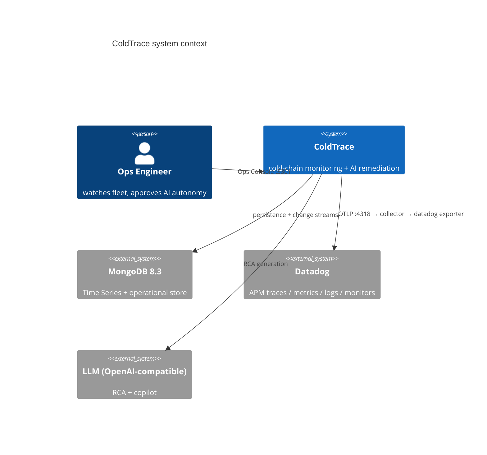
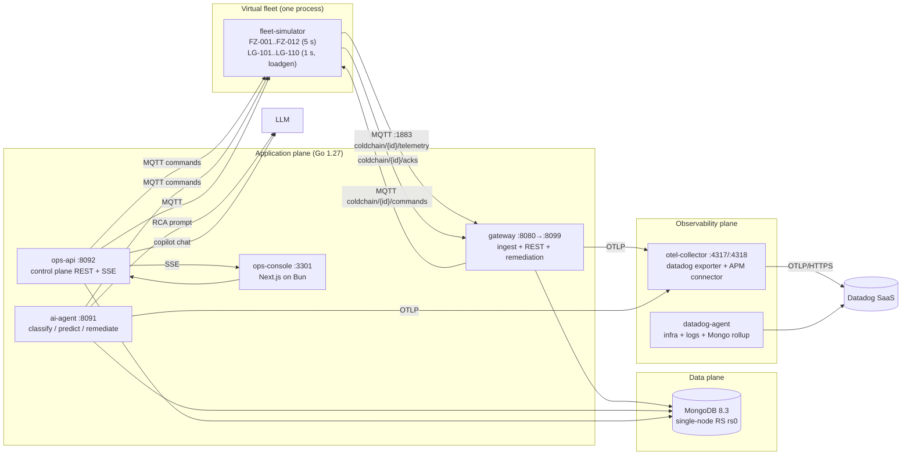
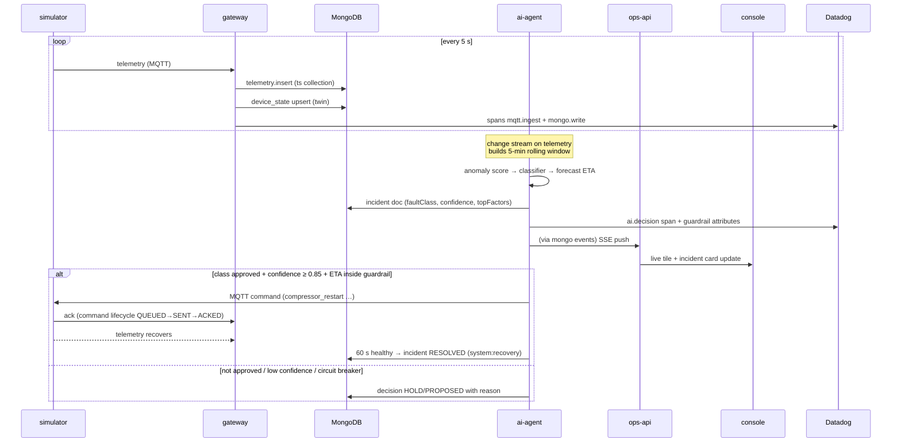
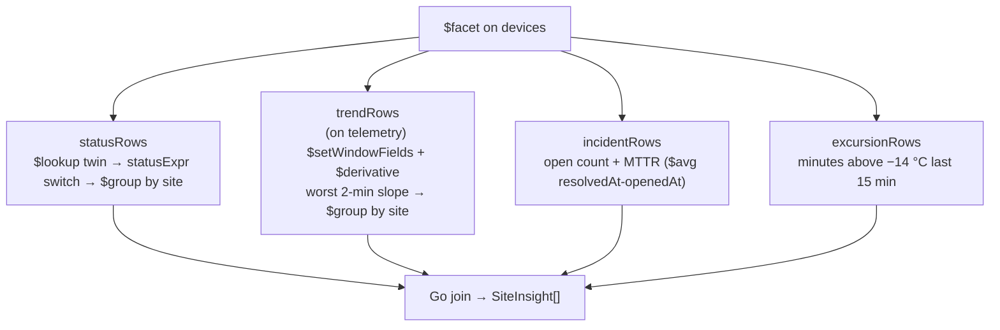
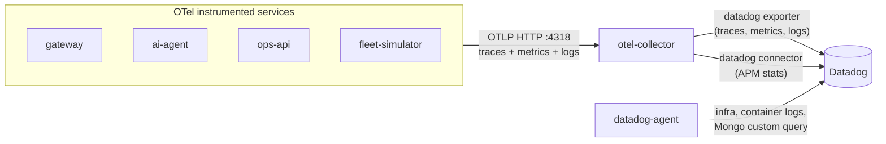

# ColdTrace — Solution Architecture

> Version 1.0 · 2026-09-28 · MongoDB + Datadog hackathon POC
> Companion doc: [solution-design.md](solution-design.md) (functional spec, data model, API contract)

ColdTrace is a cold-chain IoT monitoring platform: a simulated freezer fleet
publishes telemetry over MQTT, a Go gateway persists it into MongoDB Time
Series, an AI Ops agent classifies developing faults and remediates them
inside guardrails, and everything is observable in Datadog (OpenTelemetry).

## 1. System context



## 2. Container view



### Ports (host)

| Port | Service | Notes |
|---|---|---|
| 3301 | Ops Console | Next.js (Bun runtime), talks to ops-api |
| 8091 | ai-agent | RCA + approvals + feedback |
| 8092 | ops-api | control plane REST + SSE |
| 8099 | gateway | container :8080 |
| 4317/4318 | OTLP intake | otel-collector |
| 13133 | otel-collector | health_check readiness |
| 8125/8126 | Datadog Agent | DogStatsD / legacy APM |
| 1883 | MQTT | mosquitto |
| 27017 | MongoDB | single-node replica set |

## 3. Data flow — the incident lifecycle



## 4. Key design decisions

| # | Decision | Rationale | Alternative rejected |
|---|---|---|---|
| D1 | **MongoDB Time Series** (`granularity: minutes`, `metaField: meta` = `{deviceId, site, zone}`, TTL 24 h) | native columnar-ish storage, 50–70 % smaller IO; window pipelines run server-side | InfluxDB (extra system), plain collection (unbounded) |
| D2 | **Single-node replica set** | change streams power the ops console SSE bus and the AI agent's window feed; standalone Mongo rejects `$changeStream` (40573) | polling loops (latency + load) |
| D3 | **Change streams as the bus** — device_state/events/ai_incidents → SSE | exactly-once-ish push, no dedicated message broker for the control plane | Kafka/Rabbit (demo-scale overkill) |
| D4 | **AI reads state, gateway writes it** — single writer per collection | no write contention on the twin; agent scales independently | agent writing telemetry (race with gateway) |
| D5 | **Guardrails in code, policy in DB** — `ai_policy` re-read every cycle | kill switch takes effect in ≤ 1 evaluation cycle without redeploy | config-file policy (needs restart) |
| D6 | **OTel SDK everywhere, one OTLP endpoint** — apps emit OTLP; the collector exports to Datadog | backend swap is a collector edit, not an app change | vendor SDK (lock-in) |
| D7 | **Incident memory with in-app cosine** — 13-dim `features`, cosine ranking in Go over resolved incidents (≤200 docs, excludes the source device) | no search index to provision: runs on the stock `mongo:8.3.13` image in Compose | pgvector/external vector DB |
| D8 | **LLM engines behind an interface** — cursor → openai → template fallback | cloud agent, hosted model, or zero-key demo all work with the same console UX | hard-coded vendor |
| D9 | **Alert rules evaluated in ops-api (30 s loop)** | operator thresholds are control-plane state, not AI state; dedupe window avoids event spam | separate rules engine service |
| D10 | **Batched writes + hot/warm tiers** — `insertMany` `{ordered:false}` (100 docs / 250 ms) with bounded retries; `cmd/rollup` downsamples to hourly/daily summaries | one round trip per batch instead of per reading; raw data expires in 24 h while trends stay queryable for a year | per-reading insert (round-trip bound); no rollups (long-range queries read the raw TTL window) |

## 5. Aggregation showcase (the MongoDB depth story)

`GET /api/insights/site` runs **one `$facet`** over the devices collection with
four parallel branches joined in Go — the endpoint legitimately uses the
toolbox in a single round trip:



Other pipelines doing real work: `$derivative` for per-device `slopeCpm`
(forensics), `$setWindowFields` partitioned windows in `internal/aggdb`,
incident memory: a 13-dim statistical feature vector per incident
(temp_mean, temp_std, slope_cpm, compressor_duty, power_mean, door_events,
temp_range, slope_accel, temp_offset, drift_lag_cpm, compressor_reattain,
trend_lag_cpm, net_trend_cpm — dimension is `ai.NumFeatures`) stored on
`ai_incidents.features` and ranked by cosine similarity in the agent.

## 6. Observability architecture



- **Span vocabulary**: `mqtt.ingest` → `mongo.write` (gateway, per reading),
  `ai.decision` (agent, one per classification with `faultClass`,
  `confidence`, `etaAlarmMin`, guardrail-gate attributes, `topFactors`).
- **The trace is the audit trail**: an incident doc stores `traceId`, so the
  console deep-links from the incident card to the exact trace waterfall.
- **No vendor SDK**: apps speak OTLP only. Datadog is reachable through one
  collector config, so the instrumentation stays portable.
- **As code**: dashboard and monitors live in `datadog/dashboard.json` and
  `datadog/monitors.json` and are applied by `datadog/apply-datadog.sh`.

## 7. Deployment topology

- **Everything is compose**: `docker compose up --build -d` brings the whole
  stack, Datadog included — no profile to remember.
- **Profiles**: only `loadgen` (high-rate 10-device fleet).
- **No vector-search cluster needed**: incident memory ranks with in-app cosine
  over the 13-dim `features` (`ai.IncidentMemory`), so the demo runs on the
  stock `mongo:8.3.13` image in Docker Compose — no search index to create.
- **Single-writer rule**: gateway owns `telemetry`/`device_state`, ai-agent owns
  `ai_incidents`/`commands`, ops-api owns `events`/`alert_rules`/`policy`.

## 8. Failure modes & mitigations

| Failure | Mitigation | Observed behavior |
|---|---|---|
| Device goes silent | `lastSeenAgeSec` staleness in `statusExpr` → STALE tile; alert rule template `lastSeenAgeSec gt 60` | preflight catches leftover STALE devices |
| Broker down | gateway MQTT manager retries with backoff; commands QUEUE until broker returns | command lifecycle TIMEOUT status |
| Mongo primary stepdown | change streams auto-resume (RS); TS writes are idempotent per seq | SSE reconnects, console refetches |
| Datadog unreachable | app plane unaffected (OTLP exporter is async, `sending_queue` off = drop) | demo continues, observability gaps |
| LLM unavailable | RCA falls back to template summary; copilot falls back to rules text | UX degrades gracefully, `fallback: true` |
| Runaway AI | policy kill switch + fleet circuit breaker (N devices ALARM → HOLD) + cooldown map | verified in rehearsal (2 devices → HOLD) |

## 9. Security posture (demo scope)

- No TLS/auth inside the local compose mesh (documented tradeoff); Atlas
  migration would use `mongodb+srv` + SCRAM.
- LLM and Datadog keys stay in gitignored `.env` and are never logged.
- ops-api accepts an optional `X-Operator-Token` (open by default) and an `X-Operator` actor label (actor stamped into
  events/commands) — real deployments would put OIDC in front.

## 10. Source map

```
cmd/gateway/         ingest + REST + remediation      (Go)
cmd/ai-agent/        AI Ops agent                     (Go)
cmd/ops-api/         control plane                    (Go)
cmd/fleet-simulator/ device fleet                     (Go)
internal/sim/        device physics + fault modes
internal/ingest/     MQTT → Mongo + spans
internal/aggdb/      window-function pipelines
internal/ai/         classifier, forecast, scorer, policy, topFactors, incident memory
internal/ops/        store, hub (SSE), insights, rules
internal/copilot/    LLM engines (cursor/openai/template)
internal/modeleval/  held-out accuracy + confusion matrix
ops-console/         Next.js on Bun (fleet, devices, incidents, AI, events, compliance)
otelcol/config.yaml  OTel collector → Datadog (native exporter + APM connector)
datadog/             agent conf (MongoDB rollup), dashboard, monitors, apply script
scripts/             inject, verify_recovery, demo_preflight, demo_cleanup
```
