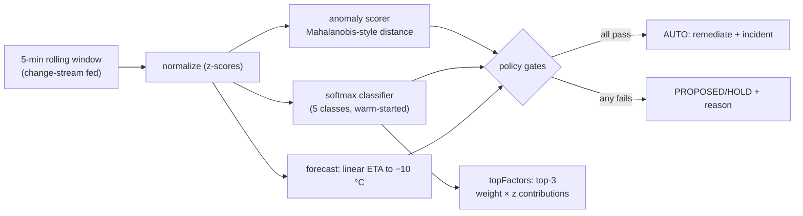

# ColdTrace — Solution Design (functional spec)

> Version 1.0 · 2026-09-28 · Companion to [solution-architecture.md](solution-architecture.md)
> This document is the behavioral contract: what the system does, what it stores,
> and what each surface exposes. Architecture doc covers how it is built.

## 1. Problem statement

A cold-chain operator runs freezer units holding premium product. A compressor
that starts degrading at 14:00 will cross the spoilage threshold (-10 °C) by
~17:30; the operator finds out at 17:45 when the temperature alarm fires —
after the product is at risk. ColdTrace closes that gap:

1. **Detect early** — statistical anomaly detection on the temperature *slope*
   fires before the absolute threshold.
2. **Diagnose** — a trained classifier names the fault, explains its decision,
   and an LLM writes a human-readable root-cause analysis.
3. **Act inside guardrails** — the agent remediates autonomously only when the
   fault class is operator-approved, confidence is high, ETA is inside policy,
   and the fleet circuit breaker is not tripped.
4. **Prove it** — every step lands in MongoDB (audit collections) and Datadog
   (traces), so recovery is a queryable fact, not a screenshot.

## 2. Domain model

### 2.1 The fleet

12 freezer devices `FZ-001..FZ-012` across 3 sites (`OM-DNG-01/02/03`), plus a
10-device load generator `LG-101..LG-110` (profile `loadgen`). Each device has:

| Attribute | Example | Source |
|---|---|---|
| site / zone | OM-DNG-01 / A1 | seeded registry |
| product | premium beef | seeded registry |
| valueAtRisk | 8000 | seeded (per-product $) |
| setpoint | -18 °C | operator-adjustable (desired state) |
| reported | tempC, compressorRunning, powerDraw, doorOpen | simulator physics |

### 2.2 Fault classes (all live-classifiable)

| Class | Physics signature | Auto-remediation action |
|---|---|---|
| `compressor_failure` | slope up, compressor duty ~0, power drop | `compressor_restart` |
| `door_left_open` | door events spike, temp mean creeps, range widens | `close_door` (alert) |
| `sensor_drift` | temp reading decouples from compressor/power truth | `recalibrate_sensor` |
| `power_outage` | power 0 W, compressor never runs, slow warm ramp | `power_restore_check` |
| `healthy` | baseline duty-cycle rest | — |

### 2.3 Device status (computed, never stored raw)

```
STALE    lastSeen > 30 s old (or never seen)
ALARM    reported.tempC > -10          (spoilage risk — the hard threshold)
AT_RISK  tempC > -14
         OR tempC > desired.setpoint + 2.0   (losing ground, running or not)
         OR compressor off and tempC > desired.setpoint + 0.2
         OR slopeCPM > 0.10 °C/min over a 5-minute window  (health view only)
OK       otherwise (a cold idle compressor is normal rest, not a fault)
```

The AT_RISK rule is deliberate: a -18 °C box with the compressor resting must
not paint the fleet yellow. A running compressor is not a clean bill of health
either: at more than +2 °C above setpoint the cabinet is losing ground and the
fleet tile must agree with the slope view. Order matters:
STALE → ALARM → AT_RISK → OK.

Two views answer from different sources: `/api/fleet` reads the device twin
(`device_state`, latest reported state) and `/devices/health` reads the time
series through `$setWindowFields` and adds the slope signal. Both use the
**0.2 °C deadband** for the stopped-compressor test. A thermostat regulates
within roughly ±0.2 °C, so a bare `tempC > setpoint` test is true for a healthy
cabinet resting at -17.9 against a -18 setpoint — and the setpoint lives at
`desired.setpoint` on the twin, falling back to the registry's top-level
`setpoint`. Getting either detail wrong flickers the fleet yellow on its own
duty cycle.

The slope is a `$derivative` over a **5-minute** `$setWindowFields` range, not
a shorter one. A freezer runs a thermostat cycle (a short pull-down, then a
long coast), so a derivative window shorter than one cycle reports whichever
half of the cycle it happens to straddle — a healthy cabinet coasting reads a
rising ~+0.1 °C/min and trips AT_RISK on its own normal behaviour. Five
minutes spans a full cycle, where the climb and the pull-down cancel and only
a genuine ramp survives.

The window alone is not enough, though: the threshold has to sit clear of the
residue too, and it needs data rather than a round number. `go run
./tools/slopeprofile` drives the device simulator and reports both
distributions:

| Population | p50 | p99 | p99.9 | max |
|---|---|---|---|---|
| Healthy, ~50k 5-min windows | +0.000 | +0.054 | +0.090 | +0.105 |
| compressor_failure, 10 min in | +0.300 | — | — | — |
| power_outage, 10 min in | +0.149 | — | — | — |
| door_left_open, 10 min in | +0.100 | — | — | — |
| sensor_drift, 10 min in | **−0.252** | — | — | — |

A resting freezer therefore *does* produce short rising stretches — the coast
half of its thermostat cycle. The threshold is **+0.10 °C/min**: about the
healthy p99.9, where a 30 s poll would flicker roughly once per 33 hours, while
compressor failure and power outage trip in 60/60 seeds and a door left open in
30/60 (the rest surface through door events and a climbing mean). The original
+0.05 tripped 1.5 % of healthy samples — on 12 devices, a false AT_RISK every
ten minutes or so.

It is a single constant (`atRiskSlopeCPM`) mirrored in the Agent's
`conf.yaml` rollup, with a test that fails if it is tightened below the healthy
tail or loosened past the slowest fault.

## 3. Data model (MongoDB `coldtrace`)

> Full per-collection schema reference — every document shape, index and
> **why it exists**, the time-series/tiering design, the `$jsonSchema`
> validator, and the query-pattern → index mapping: see
> **`docs/mongodb-data-model.md`**. This section is the narrative summary.

| Collection | Type | Written by | Purpose |
|---|---|---|---|
| `telemetry` | **Time Series** (`metaField: meta` = `{deviceId, site, zone}`, `granularity: minutes`, TTL 24 h) | gateway | readings; window pipelines run here. `meta` holds only fixed labels, so `{"meta.site": …}` skips whole buckets. Written in batches via `insertMany` + `{ordered:false}`. |
| `telemetry_hourly` / `telemetry_daily` | ordinary (summary, **warm tier**) | rollup | `$group`→`$merge` rollups, `$dateTrunc` in `Asia/Ho_Chi_Minh`; 7 d / 365 d retention. Read back via `GET /api/devices/{id}/history` (`$match` first + tz-aware `$dateToString` local labels) — the tier chart in the Ops Console. Demo history can be pre-seeded (`tools/seedhistory`, simulator-consistent vectors + bucket-aligned summaries). |
| `device_state` | ordinary (twin) | gateway | latest reported + desired; SSE source |
| `devices` | ordinary | initdb | registry metadata (site, product, VAR) |
| `ai_incidents` | ordinary | ai-agent | the audit trail (§3.1) |
| `commands` | ordinary | ops-api/ai-agent | command lifecycle |
| `events` | ordinary | all three | operator-visible activity feed |
| `ai_policy` | ordinary | ops-api | guardrails (§4.2) |
| `ai_approvals` | ordinary | ops-api | per-class autonomy grants |
| `alert_rules` | ordinary | ops-api | operator thresholds (§6) |

### 3.1 The incident document (the centerpiece)

```jsonc
{
  "deviceId": "FZ-003",
  "faultClass": "door_left_open",
  "confidence": 0.94,
  "etaAlarmMin": 7.5,
  "features": [/* 13-dim vector: temp_mean, temp_std, slope_cpm, compressor_duty,
                  power_mean, door_events, temp_range, slope_accel, temp_offset,
                  drift_lag_cpm, compressor_reattain, trend_lag_cpm,
                  net_trend_cpm */],
  "decision": "AUTO",              // PROPOSED | AUTO | HOLD
  "reason": "approved class, confidence and ETA gates passed within guardrails",
  "topFactors": [                   // explainability (weight × z, signed)
    {"feature": "door_events", "z": 66.70, "weight": 0.31,
     "contribution": 20.7, "direction": "raises"}
  ],
  "similar": [{"deviceId": "FZ-004", "faultClass": "door_left_open", "score": 0.91}],
  "traceId": "…",                   // deep-link to the ai.decision trace
  "rca": {"summary": "…", "rootCause": "…", "evidence": ["…"],
          "actions": ["…"], "model": "the configured model"},
  "status": "RESOLVED",
  "acknowledged": true,
  "remediatedBy": "ai-agent",
  "resolvedBy": "system:recovery",  // 60 s healthy auto-resolve
  "openedAt": "…", "resolvedAt": "…"
}
```

## 4. The AI layer

### 4.1 Decision pipeline (per device, per window)



- **Warm start**: classifier weights pre-trained on windows produced by the
  **device simulator** (`internal/sim`), driven across many seeds, phases and
  window lengths (`buildSimulatorTrainingSet`). Training on the same physics
  the fleet publishes over MQTT is what removes train/serve skew — an earlier
  version trained on hand-written generators and scored perfectly offline while
  misclassifying live data. The demo starts intelligent, then learns from
  operator feedback (`POST /incidents/{id}/feedback` → retrain signal).
- **Held-out accuracy**: `GET /api/model/eval` renders fresh windows from the
  simulator — the run-time distribution, not the training set — and reports
  accuracy + per-class P/R/F1 + confusion matrix. Current: **100 %** on 1,100
  windows (5 × 220). Surfaced as the **Model Health** card in the console.
  Re-running the eval regenerates the windows, so the number is a measurement,
  not a stored constant.
- **Explainability**: `topFactors` are the winning logit's linear terms
  (`weight[class][j] × z[j]`), ranked by |contribution| — rendered as
  contribution bars on the incident card.

### 4.2 Guardrails (policy → `ai_policy`, re-read every cycle)

| Gate | Default | Effect when violated |
|---|---|---|
| class approved | — | decision = PROPOSED (never auto-acts) |
| confidence | ≥ 0.85 | HOLD (no autonomous action) |
| ETA to alarm | ≤ 45 min | HOLD (too slow to matter) |
| cooldown | per device | HOLD (no repeat remediation) |
| fleet circuit breaker | ≥ 2 devices ALARM (`fleetCircuitBreaker: 2` in the seed) | HOLD everything (stop the stampede) |
| **kill switch** | off | HOLD everything instantly |

Two details that bit for real and are now pinned by tests:

- **The open gate equals the policy gate.** An incident only OPENS when the
  classifier's confidence clears the operator's `minConfidence` — the same
  number that governs autonomy. The old fixed 0.55 floor opened incidents the
  guardrails then refused (and once opened a `power_outage` at 0.58 seconds
  after a recovery), so the queue filled with unactionable noise.
- **A tripped breaker latches for the episode.** The incident carries a
  `circuitBreaker` flag; a later tick that sees the fleet calm must not flip
  the card back to AUTO and auto-remediate the very incident a human was
  asked to review. It releases when the episode resolves.

### 4.3 Recovery arc (completes detect→act→**recover**→learn)

The agent tracks a healthy streak per device; after **60 s confidently OK** it
marks OPEN incidents `RESOLVED` with `resolvedBy: system:recovery` and emits an
`ai_recovery` event. Verified live: inject `door_left_open` → ALARM → device
recovers → 60 s → auto-resolve → preflight green.

### 4.4 LLM layer (four engines, one interface)

| Engine | Trigger | Wire format | Used for |
|---|---|---|---|
| `cursor` | `CURSOR_API_KEY` set | Cursor Cloud Agents REST | RCA + copilot |
| `anthropic` | `ANTHROPIC_API_KEY` set | `POST /v1/messages` (`x-api-key`, `anthropic-version`) | RCA + copilot |
| `openai` | `OPENAI_API_KEY` set | `POST /chat/completions` (`Authorization: Bearer`) | RCA + copilot (OneNexus catalog or any gateway) |
| `template` | no keys | — | deterministic text from incident facts |

Priority is `cursor > anthropic > openai > template`. Both chat engines share
one client (`internal/llmwire`), so the provider choice is an env change: the
Anthropic engine hoists the system prompt into the top-level `system` field and
reads the reply from `content[]` text blocks, while the OpenAI engine keeps the
chat-completions shape. Streaming copilot chat speaks OpenAI SSE only, so on
the Anthropic engine it returns an explicit "not available" error rather than
misrouting — RCA over Anthropic is fully supported.

`/api/health` reports the active engine. RCA output is schema-constrained JSON
(summary, rootCause, evidence[], actions[]) parsed and persisted on the
incident; `/ai/incidents/{id}/rca` returns it.

## 5. Control plane (ops-api :8092) — API contract

All endpoints require `X-Operator` (attribution). Live updates: **SSE** at
`GET /api/stream` (change streams on device_state, events, ai_incidents).

### Read

| Endpoint | Returns |
|---|---|
| `GET /api/fleet` | DeviceRow[] (twin + computed status) |
| `GET /api/devices/{id}` | full device doc + twin |
| `GET /api/devices/{id}/series?window=60` | temp series (TS pipeline) |
| `GET /api/devices/{id}/history?tier=hourly\|daily&days=` | **tier reader** — summary buckets outliving the raw TTL, local-time labels (`$dateToString`, `Asia/Ho_Chi_Minh`) |
| `GET /api/incidents[?status=]` | Incident[] (with topFactors, similar, rca) |
| `GET /api/events?limit=` | EventRow[] |
| `GET /api/policy` / `GET /api/approvals` | guardrail state |
| `GET /api/model/eval` | accuracy + confusion matrix |
| `GET /api/insights/site` | per-site rollup ($facet showcase) |
| `GET /api/rules` | operator alert rules |

### Act

| Endpoint | Effect |
|---|---|
| `POST /api/devices/{id}/commands` | queue command (MQTT lifecycle) |
| `PUT /api/policy` | save guardrails (kill switch etc.) |
| `PUT/DELETE /api/approvals/{class}` | grant/revoke autonomy |
| `POST /api/incidents/{id}/ack` / `/resolve` / `/feedback` | workflow |
| `POST /api/ai/rca/{id}` | generate + persist RCA |
| `POST /api/ai/chat` | streaming chat (SSE deltas) |
| `POST /api/demo/inject` / `/api/demo/reset` | demo controls |
| `POST /api/rules` / `DELETE /api/rules/{id}` | manage alert rules |
| `GET /api/compliance/excursions.csv` | excursion CSV (compliance page) |

### Command lifecycle

```
QUEUED → SENT → ACKED (latency stamped)      happy path
QUEUED → TIMEOUT                             simulator never acked
SENT → FAILED                                negative ack
```

### Auth posture (deliberate, demo-scope)

The approval policy gates **what the AI may do**, not who may call the API:
`ai_policy` (minConfidence, ETA, cooldown, circuit breaker, kill switch) and
per-class `ai_approvals` are the trust boundary for autonomy. The HTTP surface
itself is intentionally open on the local demo — `OPS_TOKEN` is an optional
shared header on ops-api, and ai-agent :8091 has no auth. That is fine for a
single-operator laptop demo and NOT fine beyond it: the production path is
mutual-TLS or an OIDC proxy in front of both services, with the approval
endpoints (`PUT /api/approvals/{class}` — the autonomy grant) behind SSO and
audit-logged into `events`. Nothing here pretends otherwise.

## 6. Operator alert rules (beyond the AI path)

```jsonc
{"metric": "reported.tempC", "op": "gt", "threshold": -12,
 "severity": "critical", "deviceId": ""}   // "" = all devices
```

- Metrics: `reported.tempC`, `reported.powerDraw`, `reported.compressorRunning`,
  `lastSeenAgeSec`. Ops: `gt|lt|eq`. Severity: `info|warning|critical`.
- A 30 s evaluator loop in ops-api checks every enabled rule against live twins;
  matches write `alert_rule` events (deduped per rule+device for 5 min).
- Verified live: `lastSeenAgeSec gt 60` fired for idle loadgen devices within
  one tick; create + delete round-tripped through the console card.

## 7. Observability surfaces

| Surface | Where | What to show judges |
|---|---|---|
| Fleet overview | console `:3301/` | KPI strip + Sites strip + live grid + events |
| Incident forensics | console `/incidents/{id}` | guardrail gates, topFactors bars, similar incidents, RCA |
| Model credibility | console `/ai` | Model Health card (accuracy + confusion matrix) |
| Rule authoring | console `/events` | Alert Rules card + live firing in the feed |
| Traces | Datadog APM | `mqtt.ingest → mongo.write → ai.decision` waterfall, service map |
| Metrics | Datadog | temperature climb, fleet flat-lines, recovery slope |
| Logs | Datadog Logs | JSON decision logs with `trace_id` correlation |
| Dashboard | Datadog `app.<DD_SITE>` | "ColdTrace — Cold-chain Fleet Health" (as code: `datadog/dashboard.json`) |
| Infra | Datadog Agent | host metrics, container logs, MongoDB custom-query fleet rollup |
| Compliance | console `/compliance` | excursion CSV export |

## 8. Datadog deployment notes

- **Single backend**: apps speak OTLP only (no vendor SDK). The
  otel-collector (`otelcol/config.yaml`, contrib 0.164.0) is the one
  switchboard: it exports traces, metrics and logs with the native
  `datadog` exporter, plus APM stats through the `datadog` connector.
- **Region**: `DD_SITE` (`ap1.datadoghq.com` for APAC) selects both the
  intake endpoint (`api.<DD_SITE>`) and the UI (`app.<DD_SITE>`). The
  console builds trace deep links from `NEXT_PUBLIC_DD_SITE`.
- **Agent plane** (`datadog/agent:7.83.3`): container logs, host metrics,
  DogStatsD :8125, legacy APM :8126, and the MongoDB custom-query fleet
  rollup → `mongodb.coldchain.fleet.device_count{status:ok|at_risk|alarm}`.
- **As code**: `datadog/dashboard.json` + `datadog/monitors.json` are pushed
  by `datadog/apply-datadog.sh` (needs `DD_API_KEY` + `DD_APP_KEY`). Every
  chart and monitor is reviewable in the repo, not clicked in a UI.
- **Telemetry health**: every pipeline is `traces` / `traces/dd` (APM stats)
  / `metrics` / `logs`; `scripts/demo_preflight.sh` asserts the Agent is
  running and the collector's readiness endpoint answers.

## 9. Demo assets

| Asset | Purpose |
|---|---|
| `scripts/demo_preflight.sh` | go/no-go gate: RS primary, broker, services, fresh telemetry, fleet OK, no stale incidents, LLM configured |
| `scripts/demo_cleanup.sh` | pristine slate (resolve stale incidents, reset desired, clear demo history) |
| `scripts/inject_incident.sh` | start one fault |
| `scripts/verify_recovery.sh` | remediate + poll until OK |
| `datadog/apply-datadog.sh` | push dashboard + monitors to Datadog |
| `scripts/demo_runbook.md` | the 5-minute judging script (rehearsed ×2, log inside) |
| `docs/screenshots/architecture.png` | architecture diagram embedded in deck slide 04 |

## 10. Acceptance criteria (all verified 2026-09-28)

- [x] 12 devices OK at baseline; single-process fleet simulator + optional loadgen.
- [x] Fault injection → ALARM tile + `ai.decision` span + incident with topFactors.
- [x] Guardrails: approvals, confidence, ETA, cooldown, circuit breaker, kill switch.
- [x] Auto-remediation with command lifecycle QUEUED→SENT→ACKED (~13 ms ack).
- [x] Auto-recovery: `system:recovery` resolve after 60 s healthy streak.
- [x] Model eval: 100 % held-out accuracy, confusion matrix served + rendered.
- [x] Site insights: one `$facet`, four branches, non-empty per-site rows.
- [x] Alert rules: create → fire within 30 s → dedupe → delete.
- [x] RCA: LLM JSON persisted, `GET .../rca` returns it; fallback engine when keyless.
- [x] Datadog: traces/metrics/logs flowing; dashboard + monitors applied as code.
- [x] Preflight PASSED ×2 after cleanup; runbook updated with rehearsal log.
